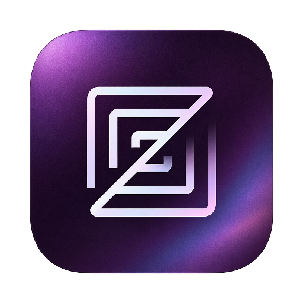

# Zed Custom

A personal fork of [Zed](https://github.com/zed-industries/zed), a high-performance, multiplayer code editor from the creators of [Atom](https://github.com/atom/atom) and [Tree-sitter](https://github.com/tree-sitter/tree-sitter).

## Installation

Zed Custom (`zedc`) coexists with upstream Zed (`zed`), and settings are seperate.

You can download a build for your platform from [Zed Custom releases](https://github.com/mos9527/zed/releases) and install.

## Additional Features
- LaTeX Math support in **Markdown, Agent Thread, and Jupyter Notebooks**

## Credits
- [zed-industries/zed](https://github.com/zed-industries/zed)
- [zed-industries/zed - Add LaTeX rendering to Markdown preview (#54668)](https://github.com/zed-industries/zed/pull/54668)

## Licensing
Per Zed, GPL-3.0 with Apache-2.0 components where marked.
